<a href="https://paramveermultani.com"><picture><source media="(prefers-color-scheme: dark)" srcset="assets/header-dark.svg"></picture></a>

  <a href="https://paramveermultani.com"><code>paramveermultani.com</code></a> ·
  <a href="https://linkedin.com/in/paramveermt"><code>linkedin</code></a> ·
  <a href="mailto:multap1@mcmaster.ca"><code>multap1@mcmaster.ca</code></a>

<picture><source media="(prefers-color-scheme: dark)" srcset="assets/section-now-dark.svg"></picture>

<picture><source media="(prefers-color-scheme: dark)" srcset="assets/now-dark.svg"></picture>

<picture><source media="(prefers-color-scheme: dark)" srcset="assets/section-projects-dark.svg"></picture>

<table>
<tr>
<td width="50%"><a href="https://github.com/paramveer30/HCL-ML-Challenge"><picture><source media="(prefers-color-scheme: dark)" srcset="assets/card-attune-dark.svg"></picture></a></td>
<td width="50%"><a href="https://github.com/Nijjea1/Aero-Surrogate"><picture><source media="(prefers-color-scheme: dark)" srcset="assets/card-aero-dark.svg"></picture></a></td>
</tr>
<tr>
<td width="50%"><a href="https://github.com/paramveer30/Hex-Coach"><picture><source media="(prefers-color-scheme: dark)" srcset="assets/card-hexcoach-dark.svg"></picture></a></td>
<td width="50%"><a href="https://github.com/paramveer30/HousingHub"><picture><source media="(prefers-color-scheme: dark)" srcset="assets/card-housinghub-dark.svg"></picture></a></td>
</tr>
<tr>
<td width="50%"><a href="https://github.com/paramveer30/Lidar-Spatial-Mapping-System"><picture><source media="(prefers-color-scheme: dark)" srcset="assets/card-lidar-dark.svg"></picture></a></td>
<td width="50%"><picture><source media="(prefers-color-scheme: dark)" srcset="assets/card-decompressor-dark.svg"></picture></td>
</tr>
</table>

**Also built**

- [**Tamalife**](https://github.com/Nijjea1/Codex-Hackathon-Tamalife): subscription and warranty tracker from OpenAI Build Week, team of 4. I owned push notifications end to end.
- [**Automated Baggage Sorter**](https://github.com/paramveer30/Automated-Airport-Baggage-System): a Quanser Q-Arm that sorts luggage by barcode scan.
- [**Vantage Labs**](https://vantagelabs.vercel.app): site for the software consulting company I'm starting with two friends.

<picture><source media="(prefers-color-scheme: dark)" srcset="assets/section-experience-dark.svg"></picture>

<picture><source media="(prefers-color-scheme: dark)" srcset="assets/experience-dark.svg"></picture>

<picture><source media="(prefers-color-scheme: dark)" srcset="assets/section-stack-dark.svg"></picture>

<picture><source media="(prefers-color-scheme: dark)" srcset="assets/stack-dark.svg"></picture>

<picture><source media="(prefers-color-scheme: dark)" srcset="assets/section-contributions-dark.svg"></picture>

<picture>
  <source media="(prefers-color-scheme: dark)" srcset="https://raw.githubusercontent.com/paramveer30/paramveer30/output/snake-dark.svg">
  
</picture>

<picture><source media="(prefers-color-scheme: dark)" srcset="assets/footer-dark.svg"></picture>
