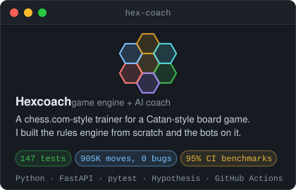

<div align="center">
  <a href="https://paramveermultani.com">
    
  </a>

  <p>
    <a href="https://paramveermultani.com"><code>paramveermultani.com</code></a> ·
    <a href="https://linkedin.com/in/paramveermt"><code>linkedin</code></a> ·
    <a href="mailto:multap1@mcmaster.ca"><code>multap1@mcmaster.ca</code></a>
  </p>
</div>

## `~/projects`

<p align="center">
  <a href="https://github.com/paramveer30/HCL-ML-Challenge"></a>
  <a href="https://github.com/paramveer30/Hex-Coach"></a>
</p>
<p align="center">
  <a href="https://github.com/paramveer30/Lidar-Spatial-Mapping-System"></a>
  <a href="https://github.com/Nijjea1/HousingHub"></a>
</p>

**Also built**
- [**Tamalife**](https://github.com/Nijjea1/Codex-Hackathon-Tamalife): subscription and warranty tracker from OpenAI Build Week, team of 4. I owned push notifications end to end.
- [**Vantage Labs**](https://vantagelabs.vercel.app): site for the software consulting company I'm starting with two friends.
- [**Automated Baggage System**](https://github.com/paramveer30/Automated-Airport-Baggage-System): a Quanser Q-Arm that sorts luggage by barcode scan.

## `~/experience`

```text
2026        Hoskin Scientific           Calibration & Test Engineering Intern
            > built a report tool: 10 min to under 1, used at every Canadian office
            > anomaly detection model (Isolation Forest) for sensors drifting in spec
            > repaired 100+ scientific instruments at the board level

2021-now    BS Transportation           Operations & Systems Coordinator
            > automated freight manifests in Python, saving 50+ hours a year
```

## `~/contributions`

<picture>
  <source media="(prefers-color-scheme: dark)" srcset="https://raw.githubusercontent.com/paramveer30/paramveer30/output/snake-dark.svg">
  <source media="(prefers-color-scheme: light)" srcset="https://raw.githubusercontent.com/paramveer30/paramveer30/output/snake-light.svg">
  
</picture>

<p align="center"><code>basketball · ufc · chess · hiking · hip-hop · horror movies · catan</code></p>
